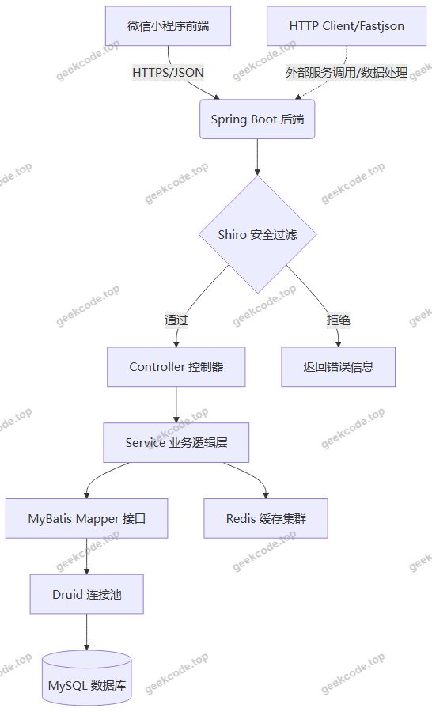
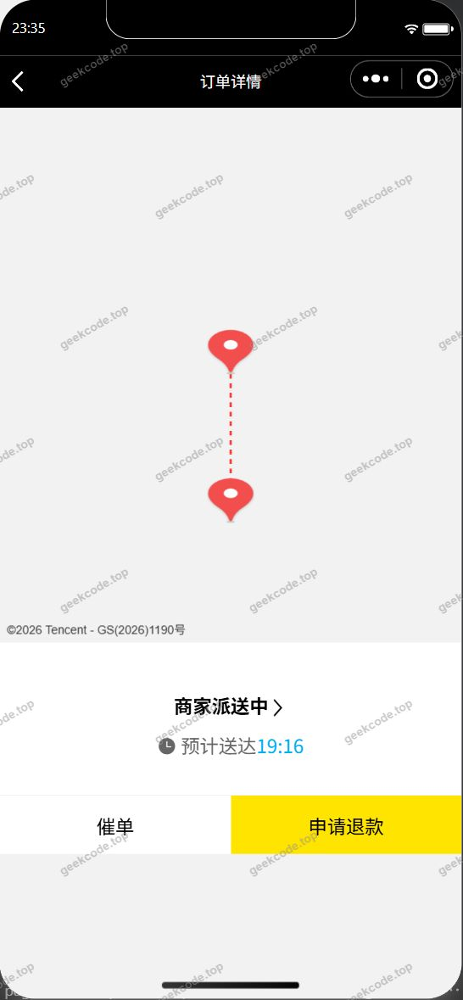
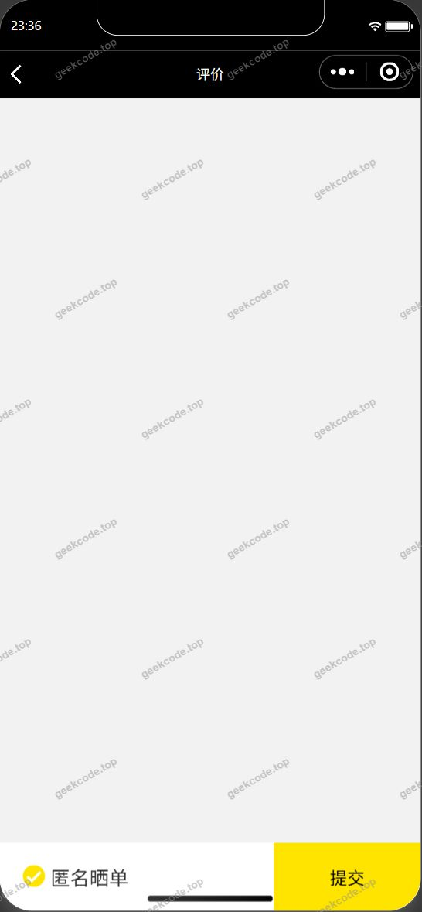
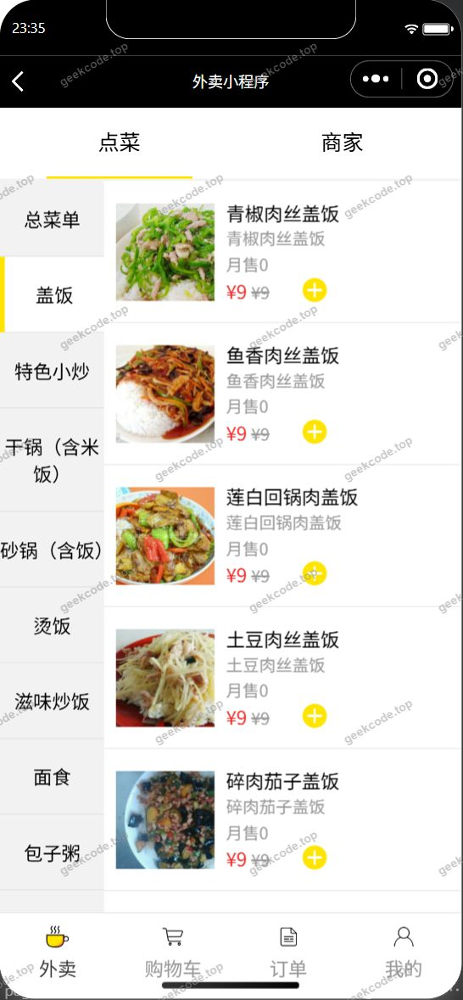
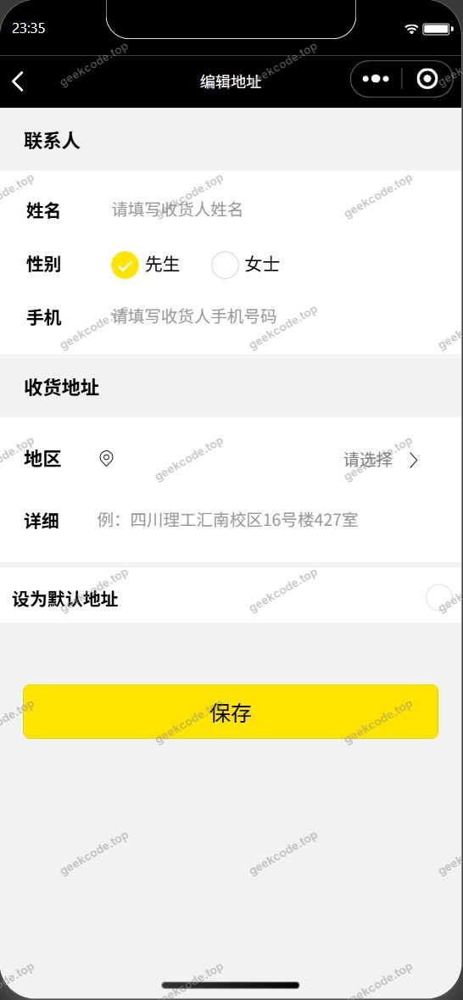
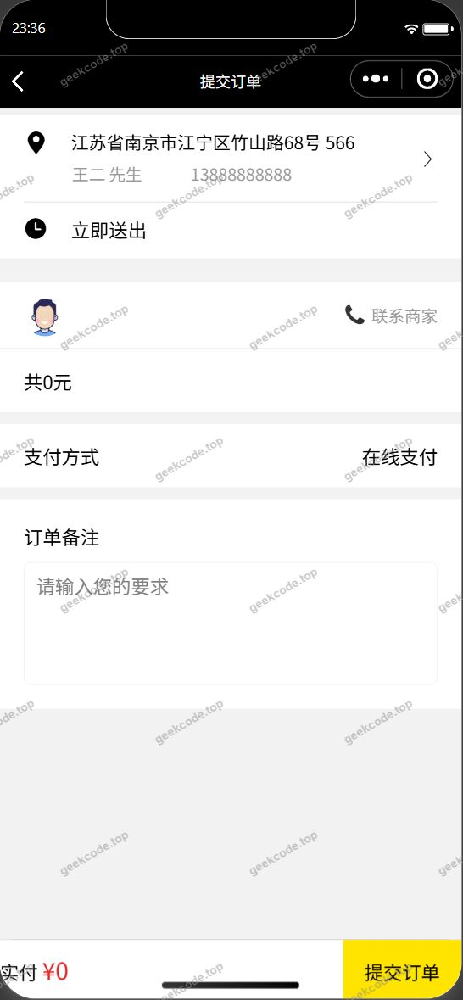

# java灵动源码-外卖小程序带后台源码

> 🎓 **计算机毕业设计 · java灵动源码-外卖小程序带后台源码**
>
> 本仓库只放**项目介绍 + 运行截图**（截图是站点带水印的原图，存在仓库 `images/` 里）。
>
> 👉 **完整可运行源码 / 数据库脚本 / 部署文档：[点我获取](https://geekcode.top/archives/java%E7%81%B5%E5%8A%A8%E6%BA%90%E7%A0%81-%E5%A4%96%E5%8D%96%E5%B0%8F%E7%A8%8B%E5%BA%8F%E5%B8%A6%E5%90%8E%E5%8F%B0%E6%BA%90%E7%A0%81?utm_source=github)**
>
> 💬 咨询微信：**ir9372**　|　🌐 更多项目：[极客代码 geekcode.top](https://geekcode.top/?utm_source=github)
>
> 📌 项目详情页：<https://geekcode.top/archives/java%E7%81%B5%E5%8A%A8%E6%BA%90%E7%A0%81-%E5%A4%96%E5%8D%96%E5%B0%8F%E7%A8%8B%E5%BA%8F%E5%B8%A6%E5%90%8E%E5%8F%B0%E6%BA%90%E7%A0%81?utm_source=github>

<table><td width="230" align="center"> <b>扫码加微信 ir9372</b></td><td valign="middle">📦 源码 = 项目介绍 + 全部运行截图 + 数据库 + 部署文档 👉 点上方任意截图，直接跳到 <b>极客代码 geekcode.top</b> 详情页</td></table>

---

<h1>java灵动源码-外卖小程序带后台源码</h1>
<h2>项目概述</h2>

本项目名为“java灵动源码-外卖小程序带后台源码”，旨在构建一个基于微信小程序与 Java 后端架构的在线餐饮配送服务平台。项目核心目标是解决传统餐饮行业数字化转型中的订单管理、用户交互及数据持久化问题，为中小型餐饮商户提供一套轻量级、可部署的外卖业务解决方案。适用人群包括餐饮经营者、系统维护人员及终端消费者。技术架构上，前端采用微信小程序原生框架实现用户端交互，后端基于 Spring Boot 框架构建 RESTful API 服务，结合 MyBatis 进行数据持久层操作，使用 Druid 连接池优化数据库访问性能，引入 Shiro 进行安全权限控制，并利用 Redis 实现缓存加速与会话管理。该系统实现了从用户登录、浏览首页、地址管理、下单支付到订单评价的全流程闭环管理，具备高可用性与易扩展性。

<h2>技术架构</h2>

本系统采用前后端分离的开发模式，整体架构分为微信小程序前端展示层、Java 后端业务逻辑层以及数据存储层。

<strong>1. 前后端交互方式</strong>
前端（微信小程序）通过 HTTPS 协议调用后端提供的 RESTful API 接口进行数据交互。后端统一返回 JSON 格式数据，前端解析后渲染页面。这种松耦合架构使得前端界面更新与后端业务逻辑迭代可以独立进行，提升了开发效率与维护便利性。

<strong>2. 核心技术选型理由</strong>

<ul>
<li><strong>Spring Boot</strong>: 作为后端主框架，利用其自动配置和起步依赖特性，简化了应用搭建过程，快速集成 Tomcat 容器（通过 <code>spring-boot-starter-tomcat</code> 依赖体现），适合快速构建微服务或单体应用。</li>
<li><strong>MyBatis</strong>: 作为 ORM 框架，提供了灵活的 SQL 映射能力，便于处理复杂的查询逻辑，同时支持注解与 XML 两种配置方式，兼顾开发效率与性能调优。</li>
<li><strong>Druid</strong>: 阿里巴巴开源的高性能数据库连接池，不仅提供标准的 JDBC 功能，还内置强大的监控统计功能，有助于实时掌握数据库运行状态及排查慢 SQL。</li>
<li><strong>Shiro</strong>: 轻量级的安全框架，负责身份认证与授权管理。在本项目中用于保护后端 API 接口，确保只有合法用户才能执行敏感操作如提交订单或修改地址。</li>
<li><strong>Redis</strong>: 内存键值对存储系统，主要用于缓存热点数据（如商品列表、用户会话信息），减轻 MySQL 数据库压力，提升系统响应速度。</li>
<li><strong>Fastjson</strong>: 高性能 JSON 序列化/反序列化工具，用于前后端数据交换格式的处理。</li>
</ul>

<strong>3. 数据库设计要点</strong>
虽然具体表结构未在上下文中详细列出，但根据功能模块推断，数据库需包含用户表、收货地址表、商品/菜单表、订单表、订单详情表及评价表。设计遵循第三范式，通过外键关联保证数据一致性。例如，订单表需关联用户 ID 与地址 ID，评价表需关联订单 ID。

<h2>功能模块</h2>

根据截图所示的小程序页面及代码上下文，系统主要功能划分为小程序用户端与 Web 后台管理端两部分。需要注意的是，现有信息中未明确展示具体的 Web 后台路由列表，以下后台功能基于典型外卖系统及后端技术栈（Shiro/Spring Boot）进行合理推断，重点描述已确认的小程序端功能。

<h3>1. 小程序用户端功能</h3>

小程序端是用户直接交互的前台界面，涵盖从注册登录到完成交易的全生命周期。

<ul>
<li><strong>用户认证模块</strong></li>
<li><strong>登录页面</strong>: 提供用户身份验证入口，支持微信一键登录或账号密码登录，对接后端 Shiro 认证机制。</li>
<li><strong>首页浏览模块</strong></li>
<li><strong>小程序首页</strong>: 展示推荐菜品、商家列表、分类导航等核心内容，支持下拉刷新与分页加载。</li>
<li><strong>跳转首页</strong>: 从其他页面快速返回主界面的导航功能。</li>
<li><strong>地址管理模块</strong></li>
<li><strong>新增收货地址</strong>: 允许用户填写并保存新的配送地址信息。</li>
<li><strong>编辑收货地址</strong>: 对已存在的地址信息进行修改。</li>
<li><strong>地址列表</strong>: 查看和管理所有已保存的收货地址，设置默认地址。</li>
<li><strong>订单交易模块</strong></li>
<li><strong>提交订单</strong>: 用户在购物车确认后，生成订单记录，选择支付方式并提交。</li>
<li><strong>订单地图追踪</strong>: 在订单详情页展示配送员位置或骑手轨迹地图，提供实时配送状态可视化。</li>
<li><strong>售后服务模块</strong></li>
<li><strong>订单评价</strong>: 用户完成订单后可对菜品质量、服务态度等进行打分和文字评论。</li>
</ul>
<h3>2. Web 后台管理端功能</h3>

Web 后台面向管理员，用于维护系统数据和业务流程。基于 Spring Boot + Shiro 架构，通常包含以下模块：

<ul>
<li><strong>系统管理</strong>: 管理员账号管理、角色权限分配（基于 Shiro）、日志审计。</li>
<li><strong>用户管理</strong>: 查看注册用户信息、封禁违规用户、重置密码。</li>
<li><strong>商品/菜单管理</strong>: 添加、编辑、删除菜品，设置价格、库存、分类及图片上传。</li>
<li><strong>订单管理</strong>: 查看所有订单状态（待支付、制作中、配送中、已完成、已取消），手动干预异常订单。</li>
<li><strong>地址库管理</strong>: 维护区域配送范围，查看用户常用地址分布。</li>
<li><strong>评价管理</strong>: 审核用户评价，回复差评，屏蔽不良言论。</li>
</ul>

<em>(注：由于上下文未提供具体的后台 Controller 列表或路由截图，上述后台功能为基于同类系统的标准配置推断，实际部署时请以具体代码为准。)</em>

<h2>用户角色与权限</h2>

系统主要涉及两类角色：普通用户（小程序端）和系统管理员（Web 后台端）。

<h3>1. 普通用户（小程序端）</h3>
<ul>
<li><strong>权限范围</strong>: 仅能访问和操作与自己账户相关的数据。</li>
<li><strong>具体功能权限</strong>:</li>
<li><strong>浏览</strong>: 公开查看首页商品、商家信息。</li>
<li><strong>个人数据</strong>: 拥有对自己收货地址的增删改查权限；只能查看自己的历史订单和当前订单状态。</li>
<li><strong>交易</strong>: 有权提交新订单、取消未支付订单、对已完成订单进行评价。</li>
<li><strong>限制</strong>: 无法访问其他用户的信息，无法修改商品价格或后台配置。</li>
</ul>
<h3>2. 系统管理员（Web 后台端）</h3>
<ul>
<li><strong>权限范围</strong>: 拥有系统最高权限，负责全局数据的维护与监控。</li>
<li><strong>具体功能权限</strong>:</li>
<li><strong>全局管理</strong>: 可对任意用户信息进行查询与管理（如禁用账号）。</li>
<li><strong>业务运营</strong>: 完全控制商品上架下架、价格调整、库存修改。</li>
<li><strong>订单处理</strong>: 可查看全平台所有订单，执行发货、退款、关闭订单等操作。</li>
<li><strong>内容审核</strong>: 管理所有用户的评价内容。</li>
<li><strong>系统配置</strong>: 维护基础字典数据、轮播图配置等。</li>
</ul>

<em>(注：若系统存在“商家”独立角色，则商家权限介于用户与超级管理员之间，仅能管理自己店铺的商品与订单。鉴于上下文未明确区分“平台管理员”与“商家管理员”，此处统一归为后台管理角色。)</em>

<h2>项目特色与创新点</h2>
<ol>
<li>
<strong>地理位置可视化集成</strong>:
   项目在订单流程中集成了“订单 Map”功能，将 LBS（基于位置的服务）技术与外卖业务场景深度结合。用户不仅能看到文本形式的配送进度，还能通过地图直观了解骑手位置，提升了用户体验的信任感和透明度。

</li>
<li>
<strong>高效的安全与性能架构</strong>:
   采用 Shiro 进行细粒度的权限控制，确保了 API 接口的安全性，防止越权访问。同时，引入 Redis 作为缓存中间件，有效缓解了高并发场景下数据库的压力，特别是在首页商品列表加载和用户会话保持方面表现优异。Druid 连接池的使用进一步保障了数据库连接的稳定性和可监控性。

</li>
<li>
<strong>完整的业务闭环设计</strong>:
   从“新增/编辑地址”到“提交订单”再到“订单评价”，系统覆盖了外卖消费的核心链路。特别是地址管理的 CRUD（增删改查）功能完善，配合订单提交时的地址校验，保证了配送信息的准确性。

</li>
<li>
<strong>轻量化与易部署</strong>:
   基于 Spring Boot 的嵌入式 Tomcat 设计，使得后端服务无需依赖外部 Servlet 容器即可独立运行，降低了运维复杂度。前端采用微信小程序原生开发，无需安装 App，依托微信生态流量，具有获客成本低、传播速度快的特点。

</li>
</ol>
<h2>部署环境</h2>

为确保系统正常运行，需准备以下软件环境与硬件资源：

<h3>1. 后端服务器环境</h3>
<ul>
<li><strong>操作系统</strong>: Linux (CentOS 7+/Ubuntu 20.04+) 或 Windows Server。</li>
<li><strong>JDK 版本</strong>: JDK 1.8 或更高版本（建议 JDK 8，兼容性好）。</li>
<li><strong>数据库</strong>: MySQL 5.7 或 MySQL 8.0。需创建对应数据库实例并导入初始化脚本。</li>
<li><strong>缓存服务</strong>: Redis 5.0+。需启动 Redis 服务并配置密码保护。</li>
<li><strong>Web 容器</strong>: 内置于 Spring Boot 的 Apache Tomcat（无需单独安装外部 Tomcat，除非有特殊需求）。</li>
</ul>
<h3>2. 前端开发与环境</h3>
<ul>
<li><strong>微信开发者工具</strong>: 最新稳定版，用于小程序的代码编译、调试与预览。</li>
<li><strong>Node.js</strong>: v12+（若小程序工程中有 npm 包依赖或构建脚本需要）。</li>
<li><strong>小程序 AppID</strong>: 需在微信公众平台申请个人或企业小程序账号，获取唯一的 AppID 用于真机调试和发布。</li>
</ul>
<h3>3. 网络与配置要求</h3>
<ul>
<li><strong>域名备案</strong>: 微信小程序要求后端 API 必须使用 HTTPS 协议，且域名需在微信后台配置为合法请求域名。因此，服务器需绑定已备案的域名并配置 SSL 证书。</li>
<li><strong>防火墙设置</strong>: 开放服务器端口（通常为 8080 用于后端服务，443 用于 HTTPS 转发，6379 用于 Redis - 仅限内网访问）。</li>
<li><strong>依赖库</strong>: Maven 或 Gradle 用于管理 Java 依赖（如 fastjson, httpclient, shiro, mybatis 等）。</li>
</ul>
<h2>五、技术特性</h2>
<ul>
<li>服务端模板渲染（JSP）</li>
<li>集成 Shiro 权限框架实现角色权限控制</li>
<li>使用 Redis 缓存提升系统性能</li>
</ul>
<h2>六、功能模块截图</h2>
<h3>微信小程序用户端</h3>
<h4>小程序-地址</h4>

<h4>小程序-订单Map</h4>

<h4>小程序-评价</h4>

<h4>小程序-首页</h4>

<h4>小程序-新增收货地址</h4>

<h4>小程序-edit收货地址</h4>

<h4>小程序-submit订单</h4>

---

## 获取完整源码

| 项目 | 说明 |
| --- | --- |
| 项目名 | java灵动源码-外卖小程序带后台源码 |
| 运行截图 | 本文 8 张（站点带水印原图，仓库 `images/` 目录） |
| 完整源码 | [https://geekcode.top/archives/java%E7%81%B5%E5%8A%A8%E6%BA%90%E7%A0%81-%E5%A4%96%E5%8D%96%E5%B0%8F%E7%A8%8B%E5%BA%8F%E5%B8%A6%E5%90%8E%E5%8F%B0%E6%BA%90%E7%A0%81?utm_source=github](https://geekcode.top/archives/java%E7%81%B5%E5%8A%A8%E6%BA%90%E7%A0%81-%E5%A4%96%E5%8D%96%E5%B0%8F%E7%A8%8B%E5%BA%8F%E5%B8%A6%E5%90%8E%E5%8F%B0%E6%BA%90%E7%A0%81?utm_source=github) |
| 咨询微信 | **ir9372**（备注：jingpin-yuanma） |
| 更多项目 | [极客代码 geekcode.top](https://geekcode.top/?utm_source=github) |

> 需要源码、部署、改配置、跑不起来等问题，加微信 ir9372 沟通，说明项目名即可。
